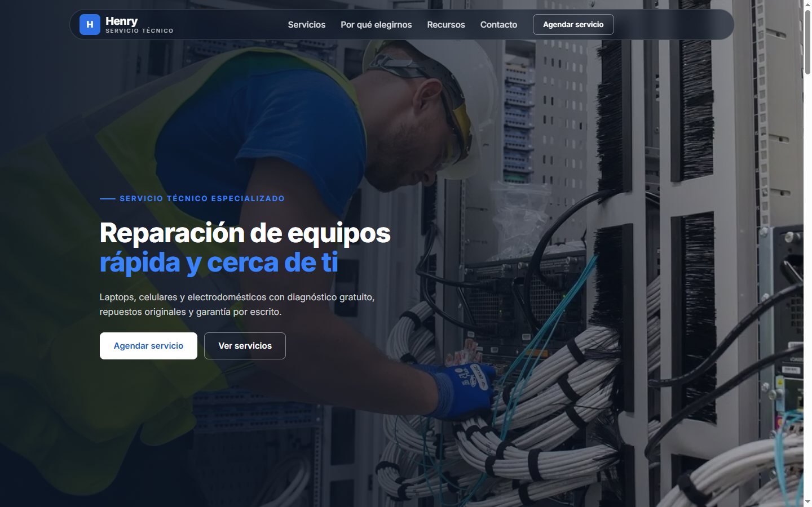

# Henry — Electronics Repair Landing Page

A service-business landing page for an electronics repair technician: services, common problems, why-us, resources, FAQ and contact. Hand-written HTML, CSS and JavaScript, with no framework or build step.



## What it is

A one-page site for a fictional repair technician: floating pill header, full-bleed hero, a common-problems grid with an overlapping featured card, 2×2 service cards, an inset CTA band, progressive why-us rows, resource cards, a two-column FAQ and a contact band.

It is a front-end showcase, not a booking product. The brand, testimonials, statistics and contact details are illustrative; the form validates in the browser and shows a success state.

## Why this build

- **Layout rebuilt from a reference design.** The section rhythm and composition follow a service-business reference; the brand, copy, palette and implementation are original.
- **Design system.** Navy and blue, Inter 700/800 for headings, fluid `clamp()` type, soft cards and rounded buttons.
- **Accessible (WCAG 2.1 AA).** Skip link, semantic landmarks, visible focus, labeled fields and `prefers-reduced-motion`.
- **Working CTA band.** A phone input prefills the contact form and scrolls to it — small, but it closes the gap between interest and action.
- **Performance.** WebP images, inline SVG icons, no jQuery or icon fonts, deferred JavaScript.
- **SEO.** Meta description, Open Graph/Twitter cards and `ProfessionalService` JSON-LD.

## Quick start

Open `index.html` directly, or serve the folder:

```bash
python -m http.server 8080
```

Visit <http://localhost:8080>.

## Project structure

```text
index.html              # The whole page
styles.css              # Design tokens, layout and components
main.js                 # Accessible nav, reveal, CTA handoff, form validation
img/                    # Optimized WebP images
docs/screenshot.webp    # README screenshot
```

## Status and scope

Live at <https://jordanroberto74.github.io/henry-tecnico/>. Brand, testimonials, statistics and contact details are demonstration content. The contact form is front-end only: it validates and shows a success state, but sends nothing.

## License

MIT. See [LICENSE](LICENSE).
